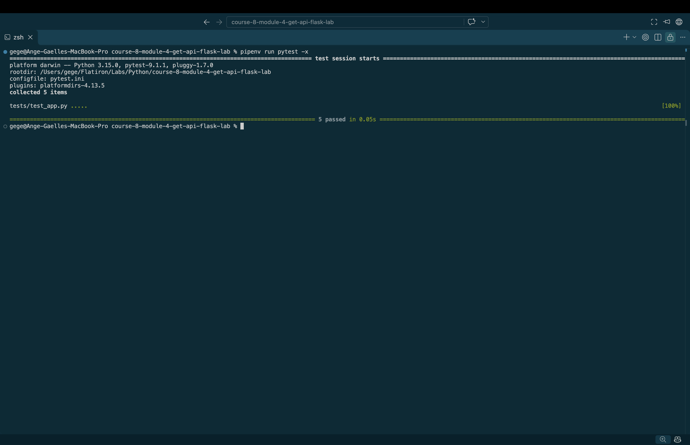

# Building RESTful GET APIs with Flask

## Overview

The goal of this lab is to build a RESTful API using Flask that handles HTTP GET requests and returns product information in JSON format.

The application simulates a simple product catalog where users can retrieve all products, search for a specific product by ID, or filter products by category.

## Learning Objectives

- Build a RESTful API using Python and Flask.
- Define routes using the `@app.route()` decorator.
- Handle HTTP GET requests.
- Return JSON responses using `jsonify()`.
- Use dynamic URL parameters to retrieve individual resources.
- Access query string parameters using `request.args`.
- Filter data based on user input.
- Handle missing resources using HTTP 404 status codes.

## Technologies Used

- Python 3
- Flask
- JSON
- Git and GitHub
- Visual Studio Code
- Pytest

### app.py

Contains the Flask application and the routes responsible for handling incoming HTTP GET requests.

### data.py

Contains the mock product data stored as a list of Python dictionaries.

Each product includes an ID, name, price, and category.

## API Endpoints

### 1. Homepage

**Endpoint:** `GET /`

Returns a welcome message confirming that the API is running.

Example request:

```http
GET http://localhost:5000/
```

Example response:

```json
{
  "message": "Welcome to the Product API!"
}
```

### 2. Retrieve All Products

**Endpoint:** `GET /products`

Returns a JSON list containing all available products.

Example request:

```http
GET http://localhost:5000/products
```

Example response:

```json
[
  {
    "id": 1,
    "name": "Laptop",
    "price": 899.99,
    "category": "electronics"
  },
  {
    "id": 2,
    "name": "Book",
    "price": 14.99,
    "category": "books"
  },
  {
    "id": 3,
    "name": "Desk",
    "price": 199.99,
    "category": "furniture"
  }
]
```

### 3. Retrieve a Product by ID

**Endpoint:** `GET /products/<int:id>`

Returns a specific product based on its ID.

Example request:

```http
GET http://localhost:5000/products/2
```

Example response:

```json
{
  "id": 2,
  "name": "Book",
  "price": 14.99,
  "category": "books"
}
```

If the requested product does not exist, the API returns a 404 status code.

Example error response:

```json
{
  "error": "Product not found"
}
```

### 4. Filter Products by Category

**Endpoint:** `GET /products?category=<category>`

Allows users to filter products by category using a query string parameter.

Example request:

```http
GET http://localhost:5000/products?category=books
```

Example response:

```json
[
  {
    "id": 2,
    "name": "Book",
    "price": 14.99,
    "category": "books"
  }
]
```

Category filtering is case-insensitive, allowing requests such as `category=Books` and `category=books` to produce the same results.

## How the Application Works

### Flask Routes

The application uses Flask's `@app.route()` decorator to connect URL paths to Python functions.

Each route handles a specific GET request and returns the appropriate response.

### JSON Responses

The `jsonify()` function converts Python dictionaries and lists into JSON responses that clients can consume.

### Dynamic URL Parameters

The `/products/<int:id>` route captures an integer from the URL and passes it to the corresponding Python function.

The function searches the product list and returns the matching product.

### Query String Parameters

The `request.args.get("category")` method retrieves the category parameter from the request URL.

If a category is provided, the application filters the product list using a list comprehension.

If no category is provided, the API returns all available products.

### Error Handling

When a requested product ID does not exist, the application returns a JSON error message with an HTTP 404 status code.

This helps clients understand that the requested resource could not be found.

## Installation and Setup

### 1. Clone the Repository

```bash
git clone git@github.com:a-gbatie/course-8-module-4-get-api-flask-lab.git
cd course-8-module-4-get-api-flask-lab
```

### 2. Install Flask

```bash
python3 -m pip install flask
```

### 3. Start the Flask Server

```bash
python3 app.py
```

The development server runs at:

```text
http://127.0.0.1:5000
```

### 4. Test the API

Open a browser and visit the following endpoints:

```text
http://localhost:5000/
http://localhost:5000/products
http://localhost:5000/products/1
http://localhost:5000/products/999
http://localhost:5000/products?category=books
```

Each endpoint returns a JSON response based on the request.

## Testing

The project uses Pytest to verify that the Flask routes behave as expected.

Run the tests using:

```bash
python3 -m pytest -x
```

The `-x` option stops execution after the first failed test, making debugging easier.

The tests check that the application:

- Returns a welcome message.
- Retrieves the complete product list.
- Retrieves individual products by ID.
- Returns a 404 response for nonexistent products.
- Filters products based on category.

## Screenshot of Completed Tests

